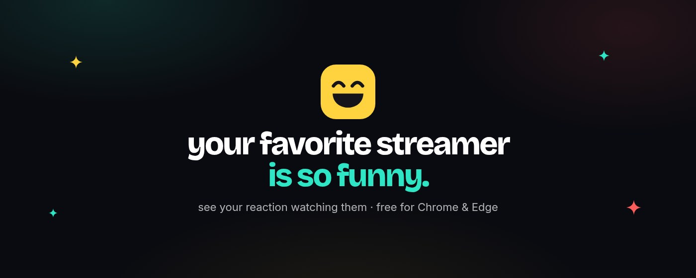
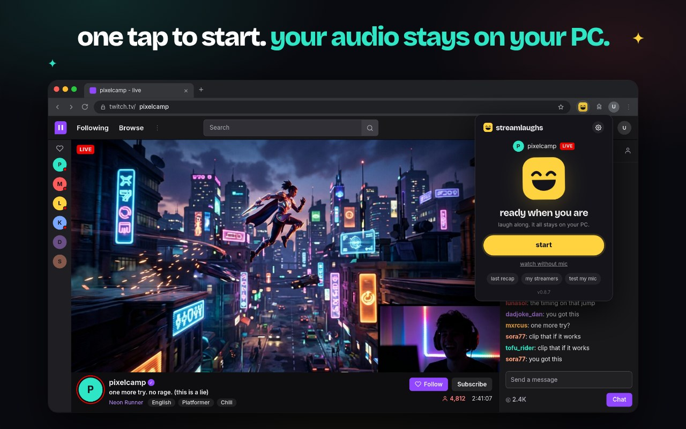
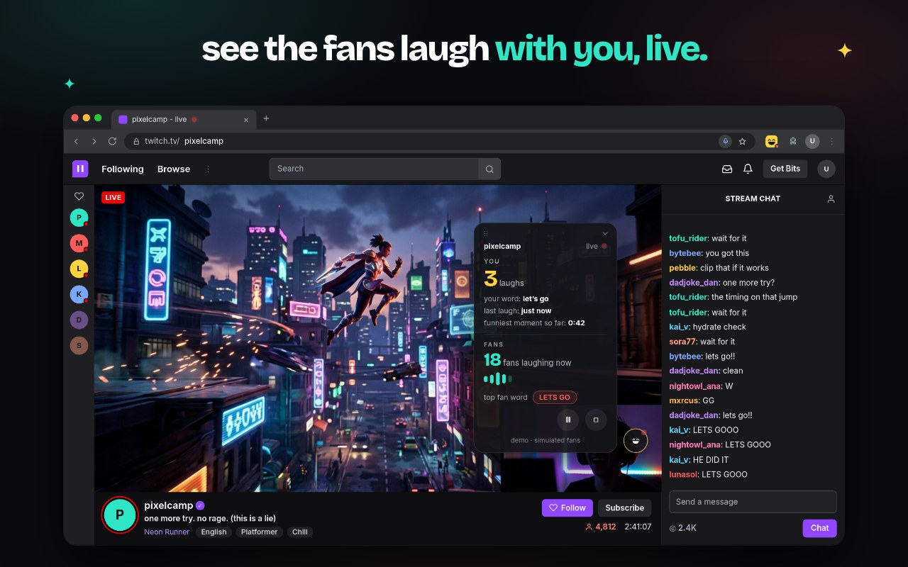
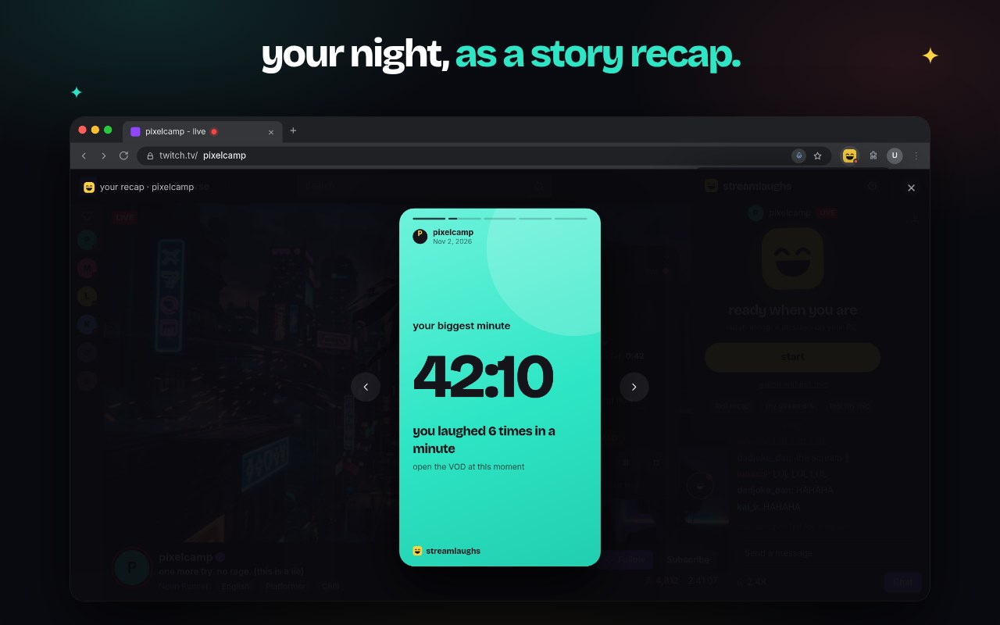
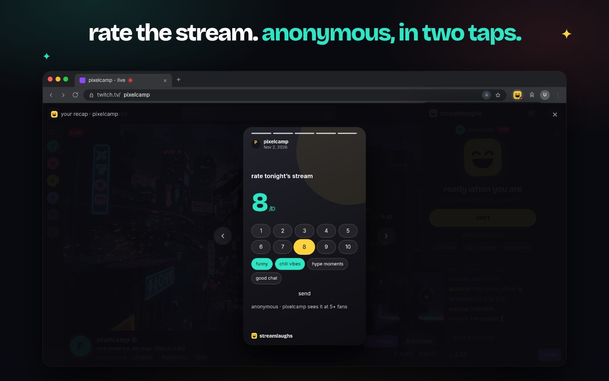
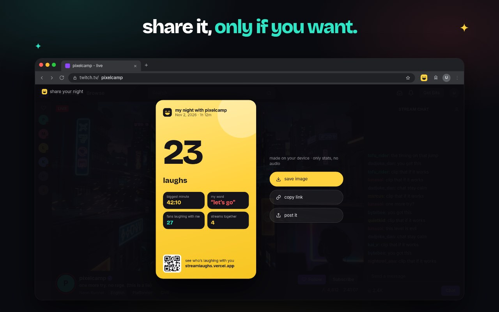
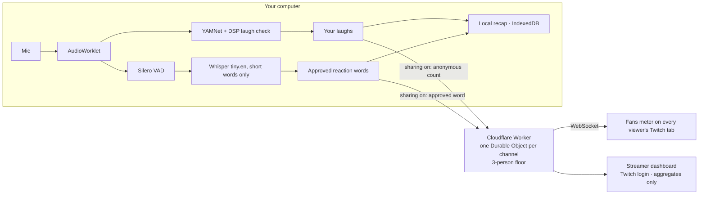

## For judges · latest build v0.8.8

**[Download StreamLaughs v0.8.8 ZIP](https://github.com/uzerkayat2004-gif/streamlaughs/releases/download/v0.8.8/streamlaughs-v0.8.8.zip)** · [website download](https://streamlaughs.vercel.app/download/zip)

The stores may show an older version. Use this ZIP to judge the latest build.

1. Unzip it.
2. Open `chrome://extensions` (or `edge://extensions`).
3. Turn on **Developer mode**.
4. Click **Load unpacked** and pick the unzipped folder containing `manifest.json`.

Then open any Twitch stream and tap the smiley. Allow the mic in Welcome; stay quiet for the three-second calibration, then laugh or say “W” or “let’s go”. The popup must show **v0.8.8**. Disable any older StreamLaughs copy so only this one runs.

Updating an existing ZIP install: replace files in the **same folder**, click **Reload**, and refresh Twitch. **Never Remove** just to update; that keeps your history. Hold the popup version number for mic/model diagnostics.

---

<div align="center">



### Your favorite streamer is so funny. See your reaction watching them.

A free Chrome and Edge extension for Twitch viewers. A small smiley dot shows how many fans are laughing with you right now, and after the stream you get your own colourful recap.
Your mic is processed **on your own computer**. Nothing you say is recorded or sent.

[](https://chromewebstore.google.com/detail/streamlaughs/lofdkbfimkjjfglhhnpkiljocbikmkej)
[](https://microsoftedge.microsoft.com/addons/detail/fkdfjgnhifofdjpbenlkhpfhmmhglmkb)
[](https://streamlaughs.vercel.app/try)

Built for the **Codex × TwitchCon Hackathon** · made with OpenAI Codex

**▶ Demo video:** coming soon

</div>

---

## The idea

A stream can make thousands of people laugh at the same second, but watching alone still feels quiet. Chat shows what people *type*, not how the room *feels*.

StreamLaughs adds a tiny smiley dot to Twitch. Press start, and it notices when **you** laugh, cheer or say things like "let's go". If you choose to share, your laugh becomes one anonymous tick in a live **fans** meter: *18 fans laughing now*. When the stream ends, you get a story-style recap of your night, and you can rate the stream for the streamer in two taps.

No uploads of your voice. No account. No chat spam. Just the feeling of laughing together.

## See it

<table>
  <tr>
    <td width="50%"></td>
    <td width="50%"></td>
  </tr>
  <tr>
    <td align="center"><b>One tap to start.</b> Audio stays on your PC.</td>
    <td align="center"><b>Laugh with the fans, live.</b> You vs. the room, on a small draggable dot.</td>
  </tr>
  <tr>
    <td width="50%"></td>
    <td width="50%"></td>
  </tr>
  <tr>
    <td align="center"><b>Your night as a story.</b> Laughs, biggest minute, your words, streams together.</td>
    <td align="center"><b>Rate the stream.</b> Anonymous, in two taps.</td>
  </tr>
  <tr>
    <td colspan="2"></td>
  </tr>
  <tr>
    <td colspan="2" align="center"><b>Share it, only if you want.</b> The card is made on your device.</td>
  </tr>
</table>

Don't want to install yet? Play the full guided demo at [streamlaughs.vercel.app/try](https://streamlaughs.vercel.app/try).

## What it does

| For viewers | For streamers |
| --- | --- |
| **Live fans meter** on the stream: fans laughing now, plus the top reaction word | **Owner-only page** after Twitch login: laugh waves over your stream, aggregates only |
| **Your laughs and words**, counted locally from your mic | **Funniest moments** with matching VOD links when Twitch has them |
| **Story recap** after each stream: your laughs, biggest minute, words and history with that streamer | **Privacy floor**: no laugh data is shown unless 3+ anonymous fans contributed |
| **Rate tonight's stream**: 1 to 10 and up to 3 reason chips, after 10+ minutes live | **Fan ratings**: average score and top reasons, only once 5+ fans rated |
| **My streamers**: every channel you watched, with laugh sparklines | No bot, no chat permission, no extra OAuth scopes |
| **Share card**: a 1080×1920 image and a stats-only link, made only when you tap share | |
| Works on live streams and on **VODs and replays** (replays stay personal) | |

## What's new in v0.8.7

- **Fan ratings.** Rate a live stream from your recap. One rating per stream, editable for 24 hours, fully anonymous. [Ratings and privacy details](docs/fan-ratings-v087.md)
- **Better detection.** Fewer false laughs from normal talking, and less model work on your PC (v0.8.6).
- **Fresh look.** A cleaner dot and fans panel, a colourful story recap and a new share card.
- **New website.** A playful home page, a guided [/try demo](https://streamlaughs.vercel.app/try) and a [for streamers](https://streamlaughs.vercel.app/streamers) page.

Full list: [release notes](docs/release-notes.md) · [build log](docs/codex-log.md)

## Install

[Add to Chrome](https://chromewebstore.google.com/detail/lofdkbfimkjjfglhhnpkiljocbikmkej) · [Get it for Edge](https://microsoftedge.microsoft.com/addons/detail/fkdfjgnhifofdjpbenlkhpfhmmhglmkb) · [Setup help](https://streamlaughs.vercel.app/install)

1. Add StreamLaughs from your browser's store and pin the smiley in the extensions menu.
2. Open any Twitch stream or replay and press **start**. Allow the mic, try "say something", and choose whether to share anonymous reactions.
3. Watch and laugh. Store copies update automatically.

Works on desktop Chrome and Edge. Store versions update after each review, so they can be a little behind the newest build.

<details>
<summary>Advanced: manual install (testers)</summary>

[Manual setup](https://streamlaughs.vercel.app/install#manual) · [Direct ZIP](https://streamlaughs.vercel.app/download/zip). Unzip to a permanent folder, open chrome://extensions (Edge: edge://extensions), turn on Developer mode, click Load unpacked and pick the folder with manifest.json.

ZIP installs don't update automatically. To update, replace the files in the same folder, click Reload, then refresh Twitch. Don't click Remove, because that deletes your local history. The ZIP build keeps the fixed ID fkocldgggcmhihelohiicoakcfomhepg.

Moving from the ZIP to the store copy: in the ZIP copy, open gear, then save my history. In the store copy, open gear, then load history, and pick that file. Nothing is uploaded. [Migration details](docs/store-installs.md)

Permissions: storage, tabs, offscreen (local mic processing), scripting (re-adds the dot to a Twitch tab that was open before install) and Twitch pages only. tabCapture is used only by an optional, off-by-default audio troubleshooting mode. [Store packages](docs/store-listing.md)

</details>

## How it works



- **Audio never leaves your computer.** It is analysed in small RAM buffers inside an offscreen document and local workers. Nothing is recorded or saved. Full transcripts are thrown away; only words on a short reaction allowlist are kept.
- **All three models ship inside the extension** (Silero VAD, YAMNet, Whisper tiny.en), running on ONNX Runtime Web and MediaPipe with WebGPU or WASM. No model is downloaded at runtime.
- **Twitch keeps playing natively.** The extension does not capture or re-route the stream's audio by default; tabCapture remains available only as an opt-in local troubleshooting reference.
- **The fans meter is anonymous.** Sharing is off until you turn it on. The Worker only accepts counts and allowlisted words, and only shows a number or word once at least three anonymous contributors sent it.
- **Streamers sign in with Twitch** (identity only, no extra scopes). The dashboard only reads data for the channel you own, and only aggregate minutes are kept, for 30 days.

Full details: [technical guide](docs/technical-guide.md) · [fans API](docs/crowd-api.md) · [threat model](docs/crowd-threat-model.md) · [privacy policy](https://streamlaughs.vercel.app/privacy)

## Built with Codex

StreamLaughs was built by one person working with **OpenAI Codex** as the engineer.

- **Planning to code.** I wrote the product brief and the design (Night Crowd: yellow, coral, teal, no Twitch purple). Codex turned it into a pnpm monorepo: the WXT extension, a Next.js website and a Cloudflare Worker, sharing one typed protocol package.
- **One scoped prompt per part.** Real mic capture and AudioWorklets, bundled on-device models, the anonymous fans backend with SQLite Durable Objects, Twitch login and the owner dashboard, the website, store packaging and auto-updates. Each prompt had a clear goal and a way to prove it.
- **Debugging on real hardware.** When real tests failed (no laughs detected, Twitch audio stuttering, false laughs from normal talking), Codex added stage counters, a hidden debug panel (Alt+Shift+D), a mic test and a "stutter lab", then reproduced each bug with recorded WAV fixtures before fixing it.
- **Proof, not promises.** Codex wrote unit, Worker (Miniflare) and Playwright tests that load the real packaged extension, plus CI that builds the store ZIP and checks the manifest.
- **Shipping.** Codex deployed the Worker with Wrangler, wired Vercel auto-deploys, and prepared the Chrome Web Store and Edge packages. Both store listings are live.

The version-by-version build log is in [docs/codex-log.md](docs/codex-log.md), and the full history of prompts and checks is in [docs/build-history](docs/build-history/).

## Tech stack

**Extension:** Chrome/Edge Manifest V3 · WXT · React 19 · TypeScript · Web Audio + AudioWorklet · Silero VAD · YAMNet (MediaPipe) · Whisper tiny.en (Transformers.js) · ONNX Runtime Web (WebGPU/WASM) · Zustand · Dexie (IndexedDB)

**Backend:** Cloudflare Workers · Hono · SQLite Durable Objects · hibernatable WebSockets

**Website:** Next.js App Router · Tailwind CSS · Twitch OAuth + Helix API · Vercel

**Tooling:** pnpm workspaces · Vitest · Playwright · Biome · GitHub Actions

## Run it yourself

Requirements: Node 24 (verified with 24.11.1), pnpm 10.33, Python 3.

```bash
git clone https://github.com/uzerkayat2004-gif/streamlaughs.git
cd streamlaughs
pnpm install --frozen-lockfile
python tools/fetch-models.py         # checks the bundled models against their SHA-256 receipts

# Extension: builds to apps/extension/.output/chrome-mv3
pnpm --filter extension build
# then Load unpacked that folder at chrome://extensions

# Website on http://localhost:3000 (public pages and /demo need no Twitch keys)
pnpm --filter web dev

# Fans backend on local Wrangler (no Cloudflare account needed)
pnpm --filter api dev
```

To point a build at the live services:

```bash
SITE_URL=https://streamlaughs.vercel.app \
VITE_CROWD_API_URL=https://streamlaughs-crowd.streamlaughs.workers.dev \
pnpm --filter extension build
```

Tests:

```bash
pnpm -r typecheck
pnpm -r test                         # unit + Worker tests
pnpm test:e2e                        # Playwright, loads the real built extension
```

Twitch app keys, Worker secrets and redirect URLs for your own deployment: [deploy guide](docs/deploy-part5.md) and [Vercel setup](docs/vercel-production.md). Never put Twitch or Worker secrets in extension build variables.

## Project structure

```
apps/extension     the Chrome/Edge extension (WXT + React)
apps/web           streamlaughs.vercel.app: home, /try demo, for streamers, install, privacy, streamer page
workers/api        the fans backend (Cloudflare Worker + Durable Objects)
packages/shared    the shared protocol, recap logic and privacy rules
tests              Playwright tests against the packaged extension
tools              model fetch, release packaging, evaluation scripts
docs               guides, screenshots and the build history
```

## Honest status

- Laugh and word detection runs fully on-device and works on real hardware. Telling a real laugh apart from normal talking is still being tuned, and we don't claim a measured accuracy number yet.
- The fans meter only shows numbers once three or more people with the extension are watching the same channel. Fewer than that shows "a few here", by design.
- The store copies update after each review, so they can lag behind the newest build.
- Fan ratings only appear for a stream once 5 or more fans rated it.

## Privacy in short

- Your audio is processed on your computer and never saved or sent.
- Sharing is optional and off by default. Only anonymous counts and approved words are sent.
- No viewer accounts, no analytics, no ads in the extension.
- Ratings are anonymous: no names, one rating per install per stream.
- Recaps live in your browser. Sharing a recap is always your own tap.

Read the full [privacy policy](https://streamlaughs.vercel.app/privacy).

## License

Code: [MIT](LICENSE). Bundled models, fonts and libraries keep their own licenses: see [THIRD_PARTY_NOTICES.md](THIRD_PARTY_NOTICES.md).

StreamLaughs is an independent project and is not affiliated with or endorsed by Twitch.
