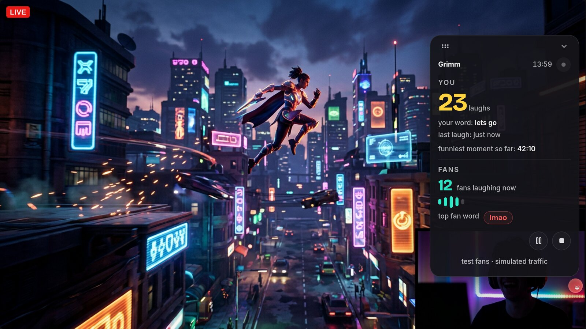
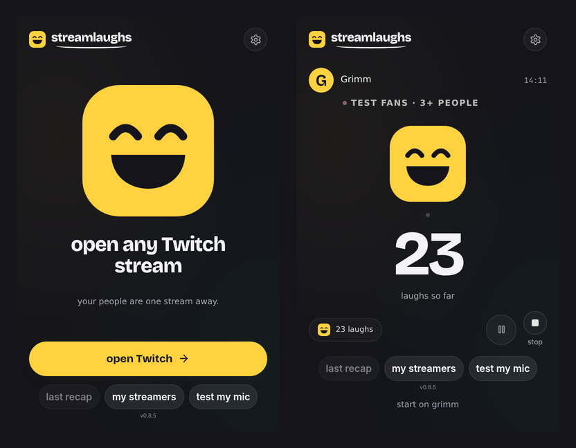
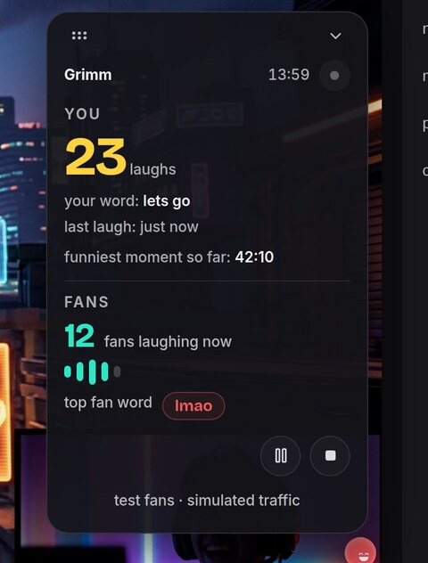
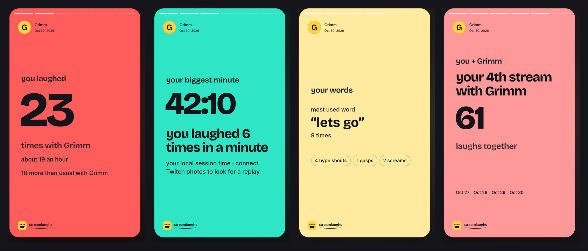
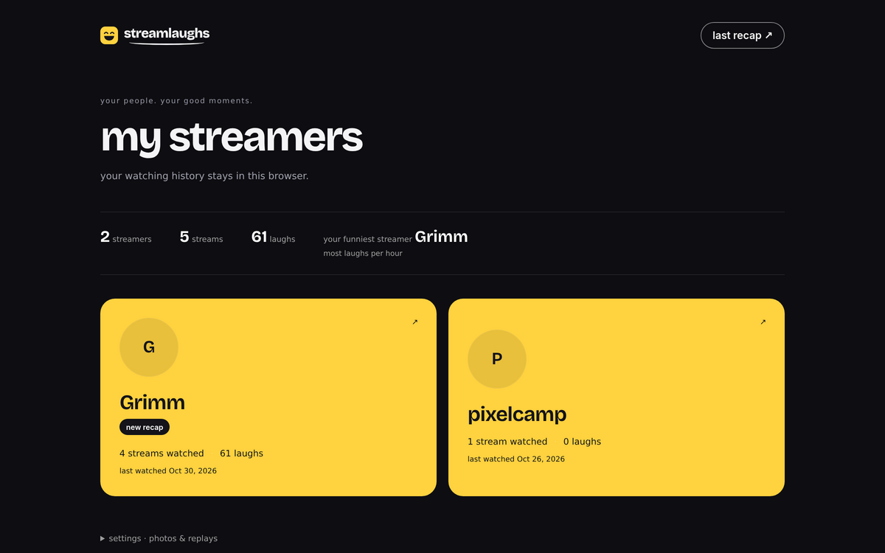
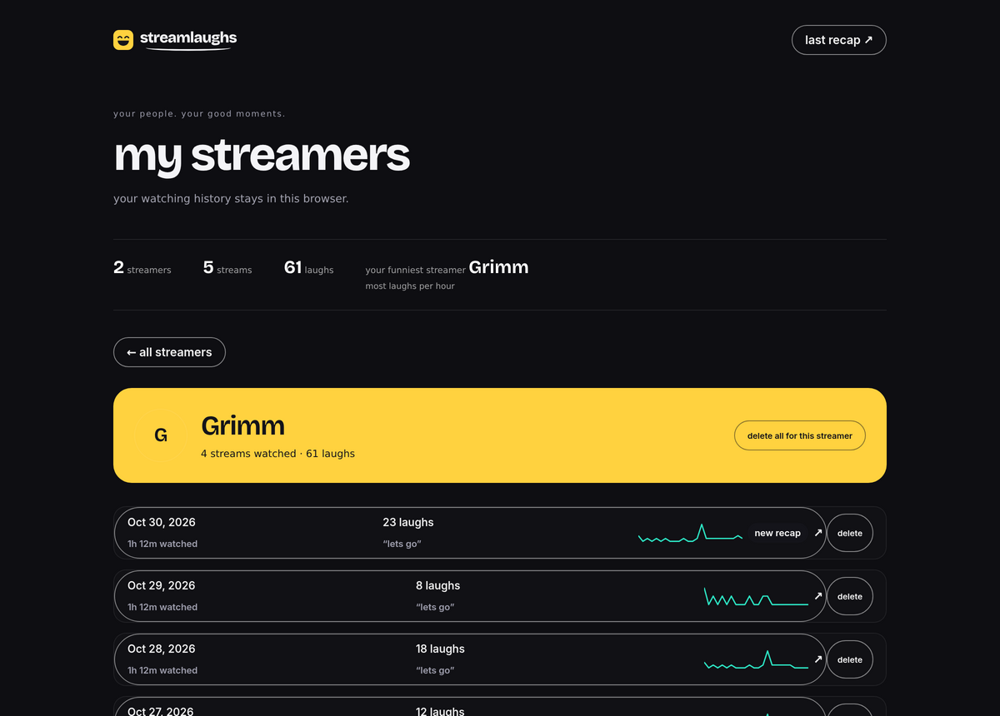
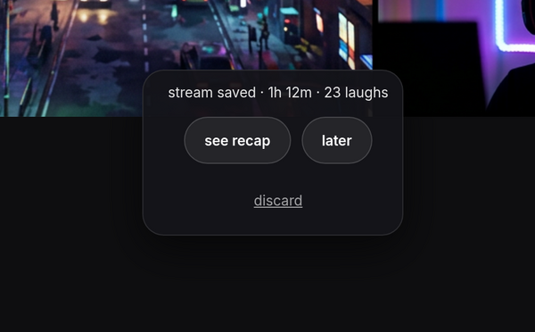
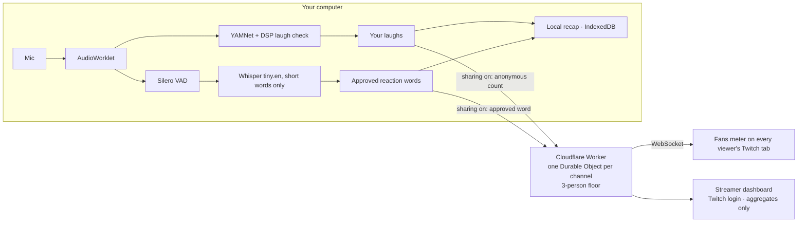

<div align="center">


A free Chrome and Edge extension that lets Twitch viewers feel the room laugh together.
Your mic is processed **on your own computer**. You choose whether to send anonymous reactions and stream ratings.

[](https://chromewebstore.google.com/detail/streamlaughs/lofdkbfimkjjfglhhnpkiljocbikmkej)
[](https://microsoftedge.microsoft.com/addons/detail/fkdfjgnhifofdjpbenlkhpfhmmhglmkb)
[](https://streamlaughs.vercel.app)

Built for the **Codex × TwitchCon Hackathon** · made with OpenAI Codex

<br />



<sub>The StreamLaughs panel on a Twitch stream (demo data, labelled "test fans · simulated traffic").</sub>

</div>

---

**v0.8.7:** rate a live stream from your recap. Scores and up to three reason chips stay anonymous; only the streamer sees averages after five fans rate. [Ratings and privacy details](docs/fan-ratings-v087.md). Native audio and detection are unchanged.

## The idea

A stream can make thousands of people laugh at the same second, but watching alone still feels quiet. Chat shows what people *type*, not how the room *feels*.

StreamLaughs adds a tiny dot to Twitch. Press start, and it notices when **you** laugh, cheer or say things like "let's go". If you choose to share, your laugh becomes one anonymous tick in a live **fans** meter that everyone with the extension sees: *12 fans laughing now*. When the stream ends, you get a colourful, Wrapped-style recap of your night.

No uploads of your voice. No account. No chat spam. Just the feeling of laughing with a crowd.

## What it does

| For viewers | For streamers |
| --- | --- |
| **Live fans meter** right on the stream: how many people are laughing now, plus the top reaction word | **Owner-only dashboard** after Twitch login: laugh waves over your stream, aggregate only |
| **Your laughs and words**, counted locally from your mic | **Funniest moments** with matching VOD links when Twitch has them |
| **Recap stories** after each stream: your laughs, your biggest minute, your words, your history with that streamer | **Privacy floor**: nothing is shown unless 3+ anonymous viewers contributed |
| **Rate tonight’s stream**: 1–10 and optional reason chips after 10+ minutes live | **Fan ratings**: anonymous average and top reasons from 5+ fans |
| **My streamers**: every channel you watched, with laugh sparklines | No bot, no chat permission, no extra OAuth scopes |
| **Share card**: a 1080×1920 image and a stat-only link, made only when you tap share | |
| Works on live streams and on **VODs and replays** (replays stay personal) | |

## Screenshots

<table>
  <tr>
    <td width="50%"></td>
    <td width="50%"></td>
  </tr>
  <tr>
    <td align="center"><b>Toolbar popup.</b> One button to start, live laugh count while you watch.</td>
    <td align="center"><b>Fans panel.</b> You vs. the room, attached to a small draggable dot.</td>
  </tr>
  <tr>
    <td colspan="2"></td>
  </tr>
  <tr>
    <td colspan="2" align="center"><b>Recap stories.</b> Your laughs, your biggest minute, your words and your streak with that streamer.</td>
  </tr>
  <tr>
    <td width="50%"></td>
    <td width="50%"></td>
  </tr>
  <tr>
    <td align="center"><b>My streamers.</b> Everyone you laughed with, kept in your browser.</td>
    <td align="center"><b>Streamer timeline.</b> Every saved stream with its laugh sparkline.</td>
  </tr>
</table>

<p align="center"><br /><sub>Stop a session and it's saved instantly: see the recap now, or later.</sub></p>

## Install from your browser’s store

[Add to Chrome](https://chromewebstore.google.com/detail/lofdkbfimkjjfglhhnpkiljocbikmkej) · [Get it for Edge](https://microsoftedge.microsoft.com/addons/detail/fkdfjgnhifofdjpbenlkhpfhmmhglmkb) · [Setup help](https://streamlaughs.vercel.app/install)

1. Add StreamLaughs from the store and pin the smile in your extensions menu.
2. Open any Twitch stream or replay and press start. In Welcome, allow the mic, try “say something” and choose whether to share anonymous reactions.
3. Watch together. Updates install automatically. Firefox, Safari and mobile users need desktop Chrome or Edge; the website offers links to open later.

Both listing URLs and approved store versions live in product.config.json. Store approvals are initially 0.6.4, independently of the latest manual build. The website shows an in-review note until each approval is updated.

Moving from a ZIP: gear → save my history → Switch. Add the store copy, open its gear → load history, choose the local JSON and check your recaps before removing the manual copy. Export stops/saves recording first. Imports merge by session ID without overwriting existing history or settings. Nothing is uploaded. Keep the JSON private: it includes watched channels and dates. Different extension IDs have separate storage. [Migration details and older-version limits](docs/store-installs.md).

<details>
<summary>Advanced: manual install (development/testers)</summary>

[Manual setup](https://streamlaughs.vercel.app/install#manual) · [Direct ZIP](https://streamlaughs.vercel.app/download/zip). Unzip to a permanent folder. Open chrome://extensions (Edge: edge://extensions, Brave: brave://extensions), enable Developer mode, Load unpacked and choose the folder holding manifest.json.

ZIP installs don’t update automatically. Replace all files in the same installed folder, click Reload, then refresh Twitch. Never Remove to update: that deletes local history. The fixed ZIP ID stays fkocldgggcmhihelohiicoakcfomhepg. Each main deployment rebuilds the ZIP. /download remains a store-first landing page for old links and QR codes; /version.json.downloadUrl points to the actual ZIP.

</details>

Twitch playback stays native by default. tabCapture remains used by the optional local speaker-reference stutter lab. offscreen owns local mic processing. No new permissions: getSelf needs no management permission, and the obsolete downloads permission/API is removed. History saves through a local Blob link. [Store packages and owner-only submission checklist](docs/store-listing.md).


## How it works



- **Audio never leaves your computer.** It is analysed in small RAM buffers inside an offscreen document and local workers. Nothing is recorded or saved. Full transcripts are thrown away; only words on a short reaction allowlist are kept.
- **All three models ship inside the extension** (Silero VAD, YAMNet, Whisper tiny.en), running on ONNX Runtime Web and MediaPipe with WebGPU or WASM. No model is downloaded at runtime.
- **Twitch keeps playing natively.** The extension does not capture or re-route the stream's audio by default; tabCapture remains available only as an opt-in local troubleshooting reference.
- **The fans meter is anonymous.** Sharing is off until you turn it on. The Worker only accepts counts and allowlisted words, and only shows a number or word once at least three anonymous contributors sent it.
- **Streamers sign in with Twitch** (identity only, no extra scopes). The dashboard only reads data for the channel you own, and only aggregate minutes are kept, for 30 days.

Full details: [technical guide](docs/technical-guide.md) · [fans API](docs/crowd-api.md) · [threat model](docs/crowd-threat-model.md) · [privacy policy](https://streamlaughs.vercel.app/privacy)

## Built with Codex

StreamLaughs was built by one person working with **OpenAI Codex** as the engineer.

- **Planning to code.** I wrote the product brief and the design (Night Crowd: yellow, coral, teal, no Twitch purple). Codex turned it into a pnpm monorepo: the WXT extension, a Next.js website and a Cloudflare Worker, sharing one typed protocol package.
- **One scoped prompt per part.** Real mic capture and AudioWorklets, bundled on-device models, the anonymous fans backend with SQLite Durable Objects, Twitch login and the owner dashboard, the website, store packaging and auto-updates. Each prompt had a clear goal and a way to prove it.
- **Debugging on real hardware.** When real tests failed (no laughs detected, Twitch audio stuttering, false laughs from normal talking), Codex added stage counters, a hidden debug panel (Alt+Shift+D), a mic test and a "stutter lab", then reproduced each bug with recorded WAV fixtures before fixing it.
- **Proof, not promises.** Codex wrote unit, Worker (Miniflare) and Playwright tests that load the real packaged extension, plus CI that builds the store ZIP and checks the manifest.
- **Shipping.** Codex deployed the Worker with Wrangler, wired Vercel auto-deploys, and prepared the Chrome Web Store and Edge packages. The Chrome and Edge listings are live and updates are rolling out.

The version-by-version build log is in [docs/codex-log.md](docs/codex-log.md), and the full history of prompts and checks is in [docs/build-history](docs/build-history/).

## Tech stack

**Extension:** Chrome/Edge Manifest V3 · WXT · React 19 · TypeScript · Web Audio + AudioWorklet · Silero VAD · YAMNet (MediaPipe) · Whisper tiny.en (Transformers.js) · ONNX Runtime Web (WebGPU/WASM) · Zustand · Dexie (IndexedDB)

**Backend:** Cloudflare Workers · Hono · SQLite Durable Objects · hibernatable WebSockets

**Website:** Next.js App Router · Tailwind CSS · Twitch OAuth + Helix API · Vercel

**Tooling:** pnpm workspaces · Vitest · Playwright · Biome · GitHub Actions

## Run it yourself

Requirements: Node 24 (verified with 24.11.1), pnpm 10.33, Python 3.

```bash
git clone https://github.com/uzerkayat2004-gif/streamlaughs.git
cd streamlaughs
pnpm install --frozen-lockfile
python tools/fetch-models.py         # checks the bundled models against their SHA-256 receipts

# Extension: builds to apps/extension/.output/chrome-mv3
pnpm --filter extension build
# then Load unpacked that folder at chrome://extensions

# Website on http://localhost:3000 (public pages and /demo need no Twitch keys)
pnpm --filter web dev

# Fans backend on local Wrangler (no Cloudflare account needed)
pnpm --filter api dev
```

To point a build at the live services:

```bash
SITE_URL=https://streamlaughs.vercel.app \
VITE_CROWD_API_URL=https://streamlaughs-crowd.streamlaughs.workers.dev \
pnpm --filter extension build
```

Tests:

```bash
pnpm -r typecheck
pnpm -r test                         # unit + Worker tests
pnpm test:e2e                        # Playwright, loads the real built extension
```

Twitch app keys, Worker secrets and redirect URLs for your own deployment: [deploy guide](docs/deploy-part5.md) and [Vercel setup](docs/vercel-production.md). Never put Twitch or Worker secrets in extension build variables.

## Project structure

```
apps/extension     the Chrome/Edge extension (WXT + React)
apps/web           streamlaughs.vercel.app: install, privacy, streamer dashboard
workers/api        the fans backend (Cloudflare Worker + Durable Objects)
packages/shared    the shared protocol, recap logic and privacy rules
tests              Playwright tests against the packaged extension
tools              model fetch, release packaging, evaluation scripts
docs               guides, screenshots and the build history
```

## Honest status

- Laugh and word detection runs fully on-device and works on real hardware. Telling a real laugh apart from normal talking is still being tuned, and we don't claim a measured accuracy number yet.
- The fans meter only shows numbers once three or more people with the extension are watching the same channel. Fewer than that shows "a few here", by design.
- The store copies update after each review, so they can lag behind the ZIP.

## Privacy in short

- Your audio is processed on your computer and never saved or sent.
- Sharing is optional and off by default. Only anonymous counts and approved words are sent.
- No viewer accounts, no analytics, no ads.
- Recaps live in your browser. Sharing a recap is always your own tap.

Read the full [privacy policy](https://streamlaughs.vercel.app/privacy).

## License

Code: [MIT](LICENSE). Bundled models, fonts and libraries keep their own licenses: see [THIRD_PARTY_NOTICES.md](THIRD_PARTY_NOTICES.md).

StreamLaughs is an independent project and is not affiliated with or endorsed by Twitch.
