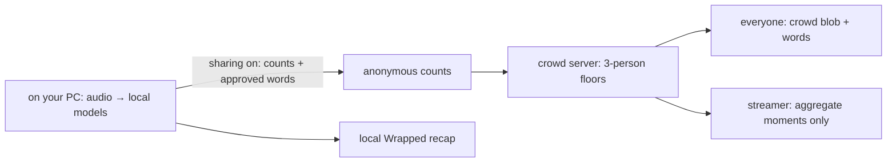

# StreamLaughs

**see who's laughing with you**

A little crowd for Twitch: your local laughs, everyone’s anonymous reactions, and a Wrapped-style recap when the stream ends.

**v0.7.0:** a quiet glass overlay, smile-only logo, history grouped by streamer, and a locally drawn story PNG. [What changed, verification and manual checks](docs/ui-v070.md).

> **Demo GIF / screenshot placeholder:** replace this line with the final crowd-blob GIF after recording. [Current extension screenshots](docs/screenshots/part6) · [Website preview](docs/screenshots/part5/home-desktop.png).

## Install in three steps

1. [Download StreamLaughs](https://streamlaughs.vercel.app/install?downloaded=1) and unzip it into a permanent folder. One ZIP contains the same extension for Windows, Mac and Linux. Mac: double-click in Finder. Linux: choose Extract here in your file manager.
2. Open `chrome://extensions` (Edge: `edge://extensions`, Brave: `brave://extensions`), enable **Developer mode**, choose **Load unpacked**, and select the extracted folder containing `manifest.json`. [Illustrated install guide](https://streamlaughs.vercel.app/install).
3. Pin the icon. Finish **Welcome → allow mic → sharing choice**, open a Twitch stream and press **start** in the toolbar popup, or **Alt+Shift+L**. “watch without mic” keeps the crowd view without opening either audio input.

To update from v0.6.2 onward, open the popup and choose **update to v…**. The extension checks and downloads the ZIP, then shows three illustrated steps: unzip, copy its contents into your **same existing folder** and replace files, then press **finish update**. It saves any active recording before reloading; recaps and settings stay saved. Refresh Twitch afterwards. Earlier installs need one manual download, same-folder replacement and reload to get this flow. [Update details and troubleshooting](docs/popup-updates-part12.md).

The **downloads** permission saves and monitors your requested ZIP-install update. Store packages omit this permission from v0.6.4 onward. Public version checks for ZIP installs are cached for up to one hour and send no account, channel or installation identifier. **Edge Add-ons is in review:** store installs use a separate ID and Edge's automatic updates, with no ZIP update button. The Install page will show its store link only after the approved URL is configured. [Store package and CI artifacts](docs/edge-store-part13.md).

Every successful main deployment rebuilds the download; no release or manual upload is needed. The fixed unpacked ID is **fkocldgggcmhihelohiicoakcfomhepg**. Parts 1–4 installs change origin once; [migration details](docs/extension-identity.md). No Chrome Web Store listing is claimed. [Download/checksum build and browser verification limits](docs/website-downloads-part8.md).

**Mic check and troubleshooting:** choose **test my mic** in the popup, then laugh or say “let’s go”. It runs the actual local models and shows a live input bar, “heard you!” or the failing stage. On Twitch, **Alt+Shift+D** opens local counters and a filtered phrase preview. **Shift-click the version** in settings for the full counter report; copied reports contain no audio or transcripts. [v0.8.0 diagnosis and proof](docs/detection-v080.md).

The **scripting** permission adds a small refresh notice to already-open Twitch tabs after an extension update. It uses only the existing Twitch host access and never reloads a tab automatically. Replace files in the same installed folder, reload the extension, then refresh Twitch; never Remove the extension.

**Live services:** [streamlaughs.vercel.app](https://streamlaughs.vercel.app) and [streamlaughs-crowd.streamlaughs.workers.dev](https://streamlaughs-crowd.streamlaughs.workers.dev/health) are connected. Twitch login works, and the owner dashboard loads live crowd and eligible aggregate history. The Cloudflare Worker uses free-plan-compatible SQLite Durable Objects; production simulator traffic stays disabled. [Deployment, connected ZIPs and safe demo instructions](docs/production-part7.md). The repository is `uzerkayat2004-gif/streamlaughs`; env overrides remain supported. Nothing has been tagged or released. Connected ZIPs are in local `releases/production/`; offline previews remain separate. Follow the [release handoff](docs/release-part6.md) before publishing. [Internal compatibility identifiers](docs/internal-identifiers.md) remain unchanged.

## Privacy in three bullets

- **Audio is processed on your PC and never saved or sent.** Bundled models use short RAM buffers; full transcripts are discarded.
- **Sharing is optional and off by default.** Only anonymous counts and allowlisted words leave the extension. Counts and each word need three anonymous contributors; this is not proof of three unique humans. Watch-only still establishes a network connection.
- **No viewer accounts or analytics.** Only eligible aggregate minutes are kept for 30 days. The website uses one essential streamer-auth cookie. Providers see network metadata; [boundaries and deletion](docs/technical-guide.md#privacy).

Profile photos are optional: sign in on the website, then choose **connect Twitch profile photos** in **my streamers** and approve access to this site. Only public channel logins go to that lookup; photos are cached locally. Recap statistics and viewing dates stay local. Initials work without permission, sign-in or a network connection. Share images are made locally from selected stats; sharing a PNG is always your action. No extra Twitch OAuth scopes or cookie-reading permission are requested.

## How it works



Chrome/Edge MV3 · WXT · React/TypeScript · Web Audio + AudioWorklet · Silero VAD / YAMNet / Whisper tiny.en · ONNX Runtime Web / MediaPipe / Transformers.js · Zustand + Dexie · Hono + Cloudflare Workers / SQLite Durable Objects / WebSockets · Next.js App Router + Tailwind · Twitch OAuth + Helix · Vercel target · pnpm / Vitest / Playwright.

## Built with Codex

The owner supplied six scoped parts and the approved Night Crowd design. Codex planned and implemented the monorepo/UI, real local audio capture, bundled inference, anonymous crowd backend, fixed identity and owner dashboard, then this release/accessibility pass. It wrote regression tests, ran local builds/browser tests, and documented failures and limits. The owner selected StreamLaughs and still registers provider accounts, verifies real hardware/OAuth, records the video and publishes. [Build log](docs/codex-log.md) · [Devpost draft](docs/devpost.md).

## Develop and verify

Node 24.11.1, Python 3 and pnpm 10.33.2 are the verified toolchain. Run commands from the repository root.

```powershell
pnpm install --frozen-lockfile
python tools/fetch-models.py
pnpm -r typecheck
pnpm -r test
$env:SITE_URL='https://streamlaughs.vercel.app'
$env:VITE_CROWD_API_URL='https://streamlaughs-crowd.streamlaughs.workers.dev'
pnpm build
pnpm --filter extension build:debug
pnpm release:preview
```

`pnpm release:version 0.7.0` changes the single product version source and regenerates notes. The manifest and website `/version.json` read `product.config.json`. Change the product name there too; ZIP filenames derive from it. Internal storage/protocol/package names stay stable. Public configuration remains `SITE_URL`, `RELEASE_REPO_OWNER`, `RELEASE_REPO_NAME`, `VITE_CROWD_API_URL`. Never put Twitch/session/Worker secrets into extension build variables.

For the local website: `pnpm --filter web dev`. Public pages and the clearly labelled recorded `/demo` need no Twitch credentials. [Provider/env setup and exact redirect URLs](docs/deploy-part5.md).

Browser tests need separate debug/ui-test/crowd-test/site-test builds; a licensed recorded human laugh/speech fixture is committed for the real-model tests. [Exact reproduction commands](docs/release-part6.md#reproduce-final-verification). The production ZIP suite also exercises actual tab capture with a test invocation grant. Physical audio/AEC, a native toolbar grant, hosted OAuth and multiple profiles need the [one final 30-minute checklist](docs/manual-part6.md). We do not claim a bug-free release or unmeasured detection accuracy.

## Submission files

- [Release workflow, ZIPs, versioning and exact publish steps](docs/release-part6.md)
- [Under-three-minute demo script + recording checklist](docs/demo-script.md)
- [Devpost draft and required personal fill-ins](docs/devpost.md)
- [Final command evidence](docs/verification-part6.txt)
- [Full technical/privacy guide](docs/technical-guide.md), [crowd API](docs/crowd-api.md), [threat model](docs/crowd-threat-model.md), [model benchmarks](docs/benchmark-part3.md)

Original code: [MIT](LICENSE). Models, fonts, runtimes and dependencies retain their [third-party licenses](THIRD_PARTY_NOTICES.md). Only the public manifest key ships; private signing material is ignored and excluded from CI and release assets.


### v0.8.0 detection and colourful recaps

The microphone pipeline was reproduced with the packaged production extension before the UI changed. See [the diagnosis and headed WAV proof](docs/detection-v080.md) and [the v0.8 UI/data notes and final acceptance steps](docs/ui-v080.md). The new laughing-face icon, glass live meter, mic check, saved-stream actions, unread recap badge, yellow/coral/teal stories, grouped streamer history and local PNG export ship together. Missing facts are skipped; fan peaks are never presented as fan totals or personal coincidence.

**Updating a ZIP install:** download from the website, unzip and replace the files in the **same existing installed folder**, click **reload** in `chrome://extensions`, then **refresh the Twitch tab**. Never click Remove. Your browser keeps its existing local recaps and settings. The popup and hidden debug panel show v0.8.0; an update also offers a glass refresh note on already open Twitch tabs.
