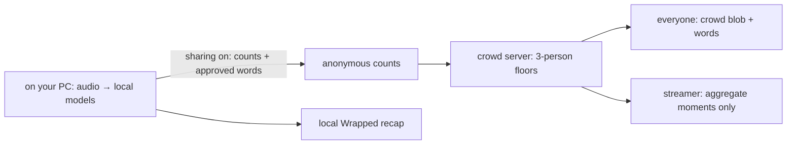

# StreamLaughs

**see who's laughing with you**

A little crowd for Twitch: your local laughs, everyone’s anonymous reactions, and a Wrapped-style recap when the stream ends.

> **Demo GIF / screenshot placeholder:** replace this line with the final crowd-blob GIF after recording. [Current extension screenshots](docs/screenshots/part6) · [Website preview](docs/screenshots/part5/home-desktop.png).

## Install in three steps

1. Once published, download the **Chrome** or **Edge** ZIP from `https://github.com/uzerkayat2004-gif/streamlaughs/releases/latest` and extract it somewhere permanent. The repository is public; the first release has not been published yet. Offline-preview ZIPs supplied locally are labelled as previews.
2. Open `chrome://extensions` (Edge: `edge://extensions`), enable **Developer mode**, choose **Load unpacked**, and select the extracted folder containing `manifest.json`.
3. Pin the icon. Finish **Welcome → allow mic → sharing choice**, open a Twitch stream and press **start** in the toolbar popup, or **Alt+Shift+L**. “watch without mic” keeps the crowd view without opening either audio input.

To update, replace the contents of the same extracted folder, reload the extension and refresh Twitch. The fixed unpacked ID is **fkocldgggcmhihelohiicoakcfomhepg** on Chrome and Edge. Parts 1–4 installs change origin once; [migration details](docs/extension-identity.md). No Chrome Web Store listing is claimed.

**Submission status:** nothing has been tagged, released or deployed. The public defaults are `uzerkayat2004-gif/streamlaughs` and `https://streamlaughs.vercel.app`; env overrides remain supported. Offline previews explicitly disable public service connections. Configure the actual Worker URL and follow the [release handoff](docs/release-part6.md) before publishing a connected build. [Internal compatibility identifiers](docs/internal-identifiers.md) remain unchanged.

## Privacy in three bullets

- **Audio is processed on your PC and never saved or sent.** Bundled models use short RAM buffers; full transcripts are discarded.
- **Sharing is optional and off by default.** Only anonymous counts and allowlisted words leave the extension. Counts and each word need three anonymous contributors; this is not proof of three unique humans. Watch-only still establishes a network connection.
- **No viewer accounts or analytics.** Only eligible aggregate minutes are kept for 30 days. The website uses one essential streamer-auth cookie. Providers see network metadata; [boundaries and deletion](docs/technical-guide.md#privacy).

## How it works



Chrome/Edge MV3 · WXT · React/TypeScript · Web Audio + AudioWorklet · Silero VAD / YAMNet / Whisper tiny.en · ONNX Runtime Web / MediaPipe / Transformers.js · Zustand + Dexie · Hono + Cloudflare Workers / SQLite Durable Objects / WebSockets · Next.js App Router + Tailwind · Twitch OAuth + Helix · Vercel target · pnpm / Vitest / Playwright.

## Built with Codex

The owner supplied six scoped parts and the approved Night Crowd design. Codex planned and implemented the monorepo/UI, real local audio capture, bundled inference, anonymous crowd backend, fixed identity and owner dashboard, then this release/accessibility pass. It wrote regression tests, ran local builds/browser tests, and documented failures and limits. The owner selected StreamLaughs and still registers provider accounts, verifies real hardware/OAuth, records the video and publishes. [Build log](docs/codex-log.md) · [Devpost draft](docs/devpost.md).

## Develop and verify

Node 24.11.1, Python 3 and pnpm 10.33.2 are the verified toolchain. Run commands from the repository root.

```powershell
pnpm install --frozen-lockfile
python tools/fetch-models.py
pnpm -r typecheck
pnpm -r test
pnpm build
pnpm --filter extension build:debug
pnpm release:preview
```

`pnpm release:version 0.7.0` changes the single product version source and regenerates notes. The manifest and website `/version.json` read `product.config.json`. Change the product name there too; ZIP filenames derive from it. Internal storage/protocol/package names stay stable. Public configuration remains `SITE_URL`, `RELEASE_REPO_OWNER`, `RELEASE_REPO_NAME`, `VITE_CROWD_API_URL`. Never put Twitch/session/Worker secrets into extension build variables.

For the local website: `pnpm --filter web dev`. Public pages and the clearly labelled recorded `/demo` need no Twitch credentials. [Provider/env setup and exact redirect URLs](docs/deploy-part5.md).

Browser tests need separate debug/ui-test/crowd-test/site-test builds and a positive local laugh fixture for the real-model test. [Exact reproduction commands](docs/release-part6.md#reproduce-final-verification). Fake media tests mic plumbing; real Twitch tabCapture/replay, physical audio, hosted OAuth and multiple profiles need the [one final 30-minute checklist](docs/manual-part6.md). We do not claim a bug-free release or unmeasured detection accuracy.

## Submission files

- [Release workflow, ZIPs, versioning and exact publish steps](docs/release-part6.md)
- [Under-three-minute demo script + recording checklist](docs/demo-script.md)
- [Devpost draft and required personal fill-ins](docs/devpost.md)
- [Final command evidence](docs/verification-part6.txt)
- [Full technical/privacy guide](docs/technical-guide.md), [crowd API](docs/crowd-api.md), [threat model](docs/crowd-threat-model.md), [model benchmarks](docs/benchmark-part3.md)

Original code: [MIT](LICENSE). Models, fonts, runtimes and dependencies retain their [third-party licenses](THIRD_PARTY_NOTICES.md). Only the public manifest key ships; private signing material is ignored and excluded from CI and release assets.
